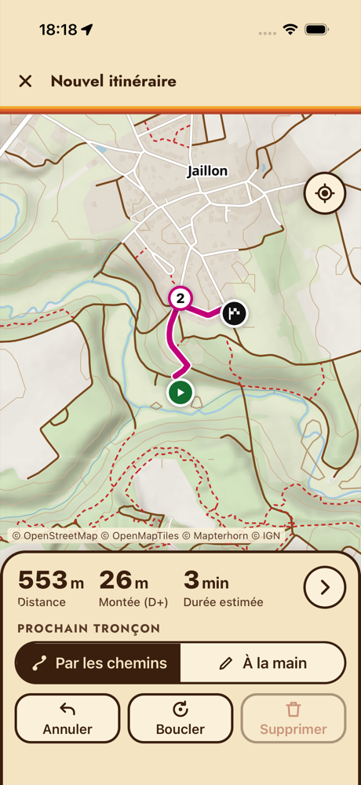
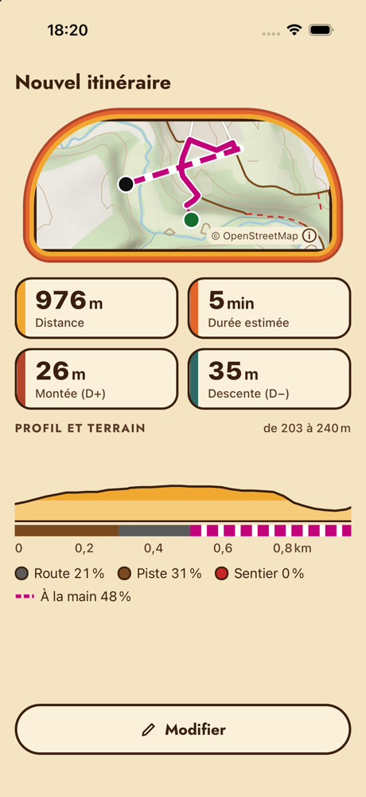
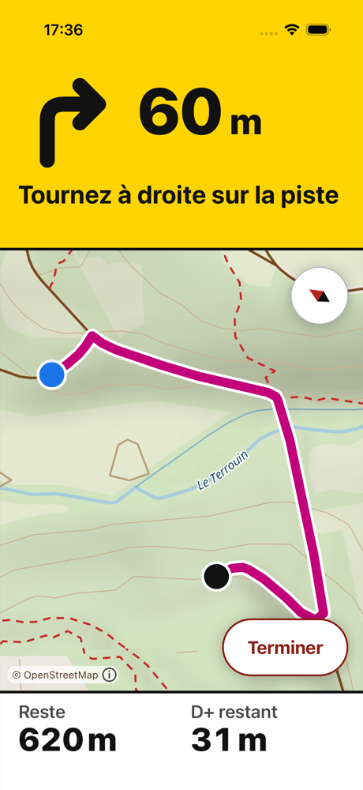
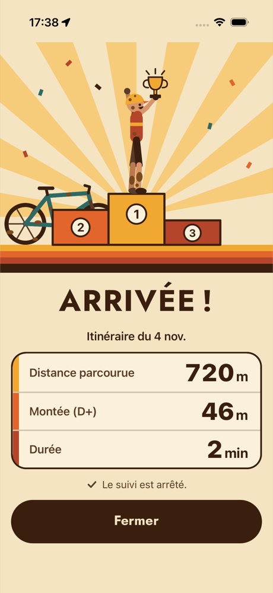

# RutaPulse

**Une application mobile de navigation VTT (vélo tout terrain) qui calcule
des itinéraires par les sentiers, directement sur le téléphone, même sans
réseau.** Android et iOS, un seul code.

> 🚧 **Projet en cours de développement.** La v1 avance phase par phase :
> la création d'itinéraires, les infos, les GPX, les circuits balisés et le
> suivi sur le vélo fonctionnent. Il reste la finition et les premiers
> essais sur un vrai téléphone.

> 🤖 **Développé avec Claude** ([Claude Code](https://claude.com/claude-code),
> d'Anthropic), selon une méthode de **développement agentique** :
> une équipe d'agents IA spécialisés, encadrée par des règles, des
> contrôles et des preuves. Le Product Owner (responsable du produit),
> Émilien, valide le design, l'architecture et chaque fusion.

<p align="center">
  
  
  
  
</p>
<p align="center"><em>Captures réelles de l'app (simulateur iOS, version finale) :
création, infos, suivi sur le vélo, arrivée.</em></p>

## Ce que fait l'app

- **Carte des sentiers hors ligne.** On télécharge une zone (environ 50 km
  de côté) : carte, relief, courbes de niveau, données de calcul. Ensuite,
  tout marche en mode avion.
- **Créer un itinéraire.** On touche un départ, des points de passage et
  une arrivée. Le chemin est calculé par les voies adaptées au VTT, **sur
  le téléphone**, et recalculé en direct quand on déplace un point. Un
  tronçon peut aussi être tracé à la main.
- **Infos de l'itinéraire.** Distance, montée et descente, profil
  d'altitude, part de route, de piste et de sentier, difficulté VTT,
  durée estimée.
- **Mes itinéraires et GPX.** Enregistrer, renommer, dupliquer, supprimer ;
  importer et exporter au format GPX (format standard des traces GPS).
- **Circuits VTT balisés.** Les circuits connus d'OpenStreetMap s'affichent
  sur la carte ; un geste en fait un itinéraire modifiable.
- **Suivi sur le vélo.** Position sur le tracé, prochaine direction écrite
  (« Tournez à droite sur le sentier »), distance et dénivelé restants,
  écart au tracé, écran toujours allumé, résumé à l'arrivée.

## Points techniques marquants

- **Calcul d'itinéraire embarqué.** Le moteur open source
  [Valhalla](https://github.com/valhalla/valhalla) tourne dans l'app, au
  travers d'un module natif écrit pour iOS (Swift) et Android (Kotlin).
  Les tracés calculés sur le téléphone sont identiques à ceux du Mac de
  référence.
- **Fabrique de zones automatisée.** Un programme Python fabrique chaque
  paquet de zone (carte PMTiles, données de calcul, altitude, circuits
  balisés remis dans l'ordre) sur une machine ARM de GitHub Actions, puis
  le publie avec un catalogue. Ajouter une zone tient en quelques lignes
  de configuration.
- **Directions recalculées au départ du suivi**, pour tout itinéraire, y
  compris un GPX importé ou un circuit, par recalage de la trace sur les
  voies (`trace_route`).
- **Design propre** : un style « affiche des années 70 » pour la
  préparation, et un écran de navigation à contraste maximal, lisible au
  soleil et avec des gants.

**Stack (ensemble des technologies)** : Expo SDK 58 et React Native 0.88,
TypeScript strict, Expo Router, MapLibre, Valhalla, SQLite, TanStack
Query, Jest, Maestro (tests de bout en bout), Python et pytest pour la
fabrique, GitHub Actions.

## La méthode : du développement agentique de qualité

Le vrai but du projet est d'apprendre à mener un développement assisté par
IA **avec le même niveau d'exigence qu'une équipe produit**. Le niveau de
process est volontairement maximal.

- **Des rôles séparés**, chacun tenu par un agent Claude avec ses propres
  consignes et ses propres droits
  ([`.claude/agents/`](.claude/agents/)) : architecte, designer,
  développeur, relecteur, testeur. Le développeur ne relit pas son propre
  code ; le testeur ne modifie jamais l'app.
- **Une session de pilotage** découpe le travail, écrit les specs,
  délègue chaque phase à une session dédiée, vérifie elle-même chaque
  compte rendu et ne parle qu'au Product Owner.
- **Un circuit fixe par phase** ([`/phase`](.claude/skills/phase/)) : spec
  validée, essai jetable avant de bâtir sur une API de plateforme, une
  tâche à la fois, relecture puis tests, un commit par tâche contrôlée.
- **Pas de succès sans preuve** ([`/verif`](.claude/skills/verif/)) :
  sorties de tests, captures en version finale, mesures, lien vers la CI
  (vérification automatique sur GitHub).
- **Des décisions écrites** : 21 ADR (fiches de décision d'architecture)
  dans [`docs/adr/`](docs/adr/), un tableau de bord
  ([`PILOTAGE.md`](PILOTAGE.md)) et un compte rendu par phase, critère par
  critère ([`docs/phases/`](docs/phases/)).
- **Des garde-fous automatiques** : TypeScript strict, ESLint (qui refuse
  les imports interdits entre dossiers), Prettier, un hook qui contrôle
  chaque fichier modifié par un agent, et la CI à chaque push.

**En chiffres** (17 novembre 2026) : 11 phases livrées en 4 semaines
(1 restante), **3 052 tests Jest** et **280 tests pytest**, 21 ADR, des
parcours Maestro sur Android et iOS.

## État d'avancement

| Phase | Contenu | État |
|---|---|---|
| 0 | Socle : app Expo, lint, tests, CI | ✅ |
| 1 | Fabrique de zones sur GitHub Actions | ✅ |
| 2 | Carte hors ligne | ✅ |
| 3 | Module natif de calcul (Valhalla) | ✅ |
| 4 | Créer et modifier un itinéraire | ✅ |
| 5 et 5b | Infos de l'itinéraire, difficulté VTT, mise à jour des zones | ✅ |
| 6 | Mes itinéraires et GPX | ✅ |
| 7 | Circuits VTT balisés | ✅ |
| 8a | Suivi sur le vélo | ✅ |
| 8b | Finitions du suivi : luminosité, carte, cap | ✅ |
| 10 | Finition et premier essai sur un vrai téléphone | à faire |

Plus tard (V2) : suivi téléphone verrouillé, guidage vocal.

## Pour aller plus loin

- Cadrage produit : [`docs/03-cadrage-produit.md`](docs/03-cadrage-produit.md)
- Architecture : [`docs/04-architecture.md`](docs/04-architecture.md)
- Découpage en phases : [`docs/05-decoupage-v1.md`](docs/05-decoupage-v1.md)
- Maquettes : [`design/`](design/)
- Règles du projet pour les agents : [`CLAUDE.md`](CLAUDE.md)

## Lancer le projet

```bash
cd mobile
npm install
npm run verify          # types, lint, tests
npx expo run:ios        # ou : npx expo run:android
```

Fabrique de zones : `cd zones && .venv/bin/python -m pytest -q`.

## Données et licences

Données cartographiques © les contributeurs
[OpenStreetMap](https://www.openstreetmap.org/copyright), OpenMapTiles,
Mapterhorn et IGN. Calcul d'itinéraire :
[Valhalla](https://github.com/valhalla/valhalla).
